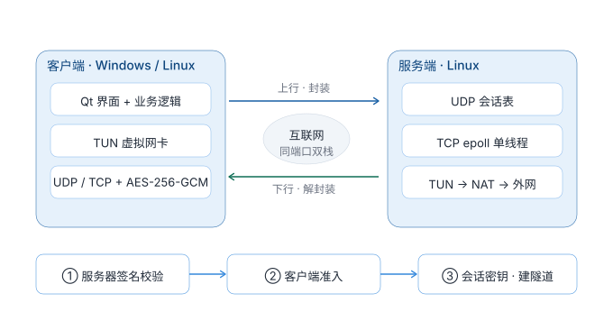

# ScholarVPN

自研 UDP/TCP 双传输隧道 + 三阶段身份认证。Windows / Linux 桌面端共用同一套 Qt 界面，移动端为 Android（Kotlin + Jetpack Compose），服务端为 Linux。

当前版本：**1.7.1**

| 端 | 技术栈 | 说明 |
|---|---|---|
| Windows | C++20 + Qt 6 + Wintun | 需管理员权限建网卡 / 改路由 |
| Linux | C++17 + Qt 6 + `/dev/net/tun` | 通过 `pkexec` 提权 |
| Android | Kotlin + Compose + `VpnService` | minSdk 29 / targetSdk 35 |
| 服务端 | C++17 + epoll（TCP）+ TUN | Linux，同端口 UDP/TCP 双栈 |

---

## ⚠️ 法律声明（Legal Notice）

**本项目仅限学习、研究和技术交流**，用于理解 VPN / 隧道 / 加密协议的工作原理。**禁止**：

- ❌ 私自搭建、运营或对外提供 VPN 服务（含付费/免费、为他人转发流量、跨境代理通道）；
- ❌ 绕过网络监管、突破防火墙、非法访问境外网络或规避任何国家/地区的法律法规；
- ❌ 用于网络攻击、数据窃取、侵犯隐私、传播违法信息等任何非法用途。

使用者须遵守**所在国家/地区的全部法律法规**。在中国境内，私自搭建/运营 VPN 服务可能违反《中华人民共和国计算机信息网络国际联网管理暂行规定》等法规，使用者自行承担全部法律责任。作者与维护者不对任何使用行为及其后果负责；下载、编译、运行或分发即视为接受本声明。

> 若无法确保使用方式合法合规，请勿使用本项目。

## 功能特性

- **双传输**：UDP 为主，运营商丢 UDP 时可切 TCP（服务端同端口双栈，一个端口同时服务两种传输）；
- **三阶段认证**：服务器身份签名（防中间人）→ X25519 密钥交换 → 客户端身份准入（注册 / 登录）；
- **流量分流**：`full`（全流量走隧道）/ `split`（国内直连、其余走隧道）/ `intranet`（只有指定内网网段走隧道）；
- **内网访问**：客户端只把 `192.168.x` 等指定网段送进隧道，其余照常走本地网络；服务端按白名单强控；
- **多服务器**：配置文件内多张卡片，GUI 内切换，断线自动重连（指数退避）；
- **DNS 防泄漏**：隧道建立后接管系统 DNS，断开时还原；分流模式下国内域名走国内上游；
- **应用内更新**：更新策略由**后台托管**（受管模式自动从 `{ServiceURL}/svc/update-policy.ini` 拉取），
  清单 Ed25519 验签 + 安装包 SHA-256 校验，支持提示 / 强制更新；
- **连接市场**：列出全部节点、实测 TCP 握手延迟（绿 <80ms / 琥珀 <160ms / 红），支持搜索与地区筛选、一键切换；
- **日志与流量**：GUI 内查看分级日志（信息 / 警告 / 错误，可按级别筛选、自动滚动）与累计、实时、峰值速率；
- **受管授权**（可选，默认关闭）：客户端可自动领取试用凭据与服务器列表，由服务端统一发号与计费；
- **用户协议门禁**：首次启动全屏展示，勾选同意后方可使用。

## 架构



客户端创建虚拟网卡，把本机流量封装进自定义报文发往服务器；服务端从 TUN 转发到真实网络，回程反向封装。默认 UDP，需要时切换 TCP（服务端 `--transport` 控制）。

客户端传输层以 `UDP` 为基类（认证 / AES-256-GCM / 心跳 / 队列全在基类），`TCP` 子类只覆写建连、发送、分帧接收三个钩子与协议版本字节（`v_udp=1` / `v_tcp=2`，错传报文在版本校验处丢弃）。全程非阻塞 socket + poll，无 sleep 轮询；服务端 TCP 为单线程 epoll。

平台差异收敛在 `src/platform/` 与各文件的 `#if defined(_WIN32)` 分支，Android 完全独立实现同一套线协议：

| 关注点 | Windows | Linux | Android |
|---|---|---|---|
| 虚拟网卡 | Wintun（持久适配器） | `/dev/net/tun` + `IFF_TUN\|IFF_NO_PI` | `VpnService.Builder` |
| 地址 / 路由 | IP Helper + `netsh` | `ip addr` / `ip route`（`0.0.0.0/1` + `128.0.0.0/1` 拆分） | `addAddress` / `addRoute` 由系统托管 |
| DNS 防泄漏 | 备份非 TUN 网卡 DNS + 黑洞 | 优先 `resolvectl`，否则改写 `/etc/resolv.conf` | `addDnsServer` + 路由强制走隧道 |
| 身份私钥 | DPAPI 加密 | 明文 + `0600` 权限 | Keystore 主密钥 + EncryptedSharedPreferences |

## 仓库结构

```
src/            客户端共享代码（GUI、传输、路由、DNS、更新、受管服务）
server/         服务端（传输层、TUN 转发、授权库、管理通道）
android/        Android 客户端
tests/          各模块测试与诊断工具
scripts/        版本号同步、分流数据生成、Linux 安装脚本
docs/           架构图、协议说明、部署文档；routing/ 下是分流网段数据
third_party/    内置依赖（OpenSSL、Wintun）
```

> **后台管理面板与发号后端不在本仓库。** 它们部署在服务器本地（`/opt`），已在 `.gitignore` 中排除，
> 本仓库只包含客户端与服务端的数据面实现。仓库里的 `tools/` 仅保留辅助脚本。

## 协议与加密

- **双传输**：自定义报文头（魔数 / 版本 / 类型 / 序号），版本字节即传输标识；线格式属实现细节，不展开；
- **三阶段认证**：服务器身份签名校验 + 客户端身份准入；**认证通过前服务端不转发任何流量**；
- **加密**：OpenSSL 标准算法（X25519 + HKDF 派生双向会话密钥），数据面 AES-256-GCM，支持前向安全；
- **重放防护**：收端滑动窗口，未通过 GCM 验证的报文不推进窗口；
- **心跳保活**：周期心跳，失联自动重连。

## 配置

客户端参数走 INI，**推荐全部在 GUI 内操作**（增删改自动维护），首次运行自动生成：

- Windows：`%APPDATA%\ScholarVPN\config.ini`
- Linux：`~/.config/scholarvpn/config.ini`（遵循 `$XDG_CONFIG_HOME`；`sudo` 运行时自动还原到调用者家目录，避免身份密钥落到 `/root`）

```ini
[Server]
Count=2

[Server1]
Name=公司服务器            # 显示名（留空默认 computer+N）
ServerIP=1.2.3.4
ServerPort=51820
Transport=0                # 0=UDP（默认） 1=TCP（运营商丢 UDP 时用，可配 443 端口）
ClientID=user1             # 显示名，不参与认证，可随意填写、无需唯一
RegisterToken=             # 首次注册填管理员下发的令牌，注册成功自动清空即登录模式
ServerPubKey=              # 可选：该服务器 Ed25519 公钥 base64；留空=用内置公钥

[Server2]
Name=home
ServerIP=5.6.7.8
ServerPort=51820
ClientID=user1

[Network]
VirtualIP=                 # 可选：留空 = 采用服务端自动分配的虚拟 IP（推荐）
VirtualPrefix=24
DNS=8.8.8.8,1.1.1.1
MTU=1400
Metric=5

[Routing]
Mode=full                  # full | split | intranet
ChinaIPList=builtin        # builtin=用 exe 同目录的 chnroute.txt（构建时自动拷贝）
IntranetSubnets=           # intranet 模式：经隧道访问的网段，逗号分隔，如 192.168.10.0/24
BypassSubnets=             # split 模式：额外不走隧道的网段（当前版本保留字段）

[Update]
PolicyURL=                 # 更新策略地址，留空则不检查更新

[Service]
Mode=off                   # off=手工填服务器  managed=自动领取凭据与服务器列表
```

> 多服务器按 `[ServerN]` 连接；**Debug** 构建在无任何 `[ServerN]` 时回退到 `192.168.1.12`（本地测试），**Release** 回退为空。
>
> `split` 模式下 DNS 默认使用国内上游（`223.5.5.5` / `119.29.29.29`），避免隧道异常时全量断网；GUI 底部的「全局」/「智能分流」按钮可直接切换（连接中不可切换）。分流网段数据在 `docs/routing/chnroute.txt`，构建时自动拷到输出目录。

## 依赖

**客户端（Windows）**

| 依赖 | 说明 |
|---|---|
| VS 2022（v143）+ Windows SDK 10 | C++20 |
| Qt 6.9.1（msvc2022_64） | GUI + **Network**（连接市场测速用）；默认引用 `D:\Qt\6.9.1\msvc2022_64`，路径不同需改 `VPN_.vcxproj` 的 Qt 路径（include 与 lib 各一处） |
| OpenSSL 3.5.6 | 已内置 `third_party/openssl`；运行需 `libcrypto-3-x64.dll` |
| Wintun 0.14.1 | 已内置 `third_party/wintun-0.14.1`；运行需 `wintun.dll` |

**客户端（Linux）**

| 依赖 | 说明 |
|---|---|
| CMake ≥ 3.16 + C++17 编译器 | GCC 9+ / Clang 10+ |
| Qt 6 Widgets / OpenSSL 3.x | 构建 `qt6-base-dev libssl-dev`，运行 `libqt6widgets6 libssl3` |
| 内核 TUN | `/dev/net/tun`（容器需 `--device /dev/net/tun`） |
| iproute2 + polkit | 路由操作用 `ip`；桌面提权用 `pkexec` |

**Android**

| 依赖 | 说明 |
|---|---|
| Android SDK 35 + Build Tools | `minSdk 29` |
| JDK 17 + Gradle Wrapper | 仓库自带 `gradlew` |
| AndroidX（Compose、Security-Crypto） | 依赖由 Gradle 自动下载 |

**服务端（Linux）**：CMake ≥ 3.16 + C++17 编译器、pthread、OpenSSL（X25519 / HKDF / AES-256-GCM）。

> 许可：Wintun 源码 GPLv2、预编译二进制另有许可（`third_party/wintun-0.14.1/prebuilt-binaries-license.txt`）；OpenSSL 见 `third_party/openssl/LICENSE`。分发前请确认兼容性。

## 构建

### 客户端（Windows）

用 VS 2022 打开 `VPN_.sln`，选 x64 + Debug/Release 生成即可；构建后自动拷贝 `libcrypto-3-x64.dll`、`wintun.dll`、`style.qss`、`chnroute.txt`、Qt6 DLL 与 `platforms` 插件到输出目录。命令行：

```powershell
msbuild VPN_.sln /p:Configuration=Debug /p:Platform=x64
```

> **Debug** 用内置测试服务器公钥，**Release** 用正式公钥（`src/client/ClientApp.cpp` 的 `kServerSigPubPem`，请自行更换）。也可在 GUI 中按服务器单独填写 `ServerPubKey`。

### 客户端（Linux）

```bash
sudo apt install build-essential cmake qt6-base-dev libssl-dev
cmake -S . -B build-client && cmake --build build-client -j
sudo ./build-client/vpn_client          # 需要 root：建 tun、改路由、改 DNS
```

**装成桌面应用（推荐）**：

```bash
sudo ./scripts/linux/install-linux.sh build-client/vpn_client
```

安装到 `/opt/scholarvpn/` 并注册应用菜单、图标、polkit 策略（认证一次记 5 分钟）、启动器与桌面快捷方式。之后按 **Super 搜 ScholarVPN** 或双击图标启动。

> GNOME Wayland 下 root 进程连不上 wayland compositor，必须走 XWayland（`QT_QPA_PLATFORM=xcb` + Mutter 的 XWayland cookie）；启动器 `scripts/linux/scholarvpn-gui` 已自动处理。无 polkit 的发行版直接 `sudo` 运行。

### Android

```bash
cd android
./gradlew :app:assembleRelease      # 产物：app/build/outputs/apk/release/
```

签名读取 `android/keystore.properties`（`storeFile` / `storePassword` / `keyAlias` / `keyPassword`）；文件缺失时自动回退 debug 签名。

### 服务端（Linux）

```bash
cd server
cmake -S . -B build && cmake --build build
sudo ./build/vpn_server -a 10.8.0.1 -p 51820
```

常用参数：`-l/--listen`、`-a/--addr`（隧道内网 IP）、`-p/--port`、`-n/--name`（TUN 网卡名）、`--prefix`、`--mtu`、`--max-clients`（默认 64）、`--transport both|udp|tcp`（默认双栈）、`-k/--key`、`-g/--gen-token [n]`（生成一次性注册令牌）、`--default-route`、`--quiet`。

**一键部署**（兼容 Debian/Ubuntu/CentOS/RHEL/Fedora/Arch/OpenWrt，自动选 iptables / nftables 并放行端口）：

```bash
cd server
sudo ./start.sh            # 前台运行（调试）
sudo ./start.sh -d         # 后台守护（异常自动重启）
sudo ./start.sh install    # 装 systemd 服务（推荐）
sudo ./start.sh status|logs|doctor|uninstall
```

关键项可用环境变量覆盖：`TUN_IP`、`TUN_PREFIX`、`TUN_MTU`、`VPN_PORT`、`LISTEN_IP`、`KEY_PATH`、`MAX_CLIENTS`、`TRANSPORT`、`QUIET`、`INTRANET_ALLOW`、`INTRANET_ENFORCE`。`install` 会把当前配置固化到 `/etc/default/vpn-server`，改完 `systemctl restart vpn-server` 生效。日志按天轮转在 `logs/`。

首次启动自动生成 `keys/server_sig.key` / `server_sig.pub`，把公钥硬编码进客户端 `kServerSigPubPem`（防中间人）。密钥与准入数据库说明见 `server/keys/README.txt`。

### 多用户（NAT 模式）

```bash
sysctl -w net.ipv4.ip_forward=1
iptables -t nat -A POSTROUTING -s 10.8.0.0/24 -o eth0 -j MASQUERADE
sudo ./build/vpn_server -a 10.8.0.1 -p 51820 --max-clients 100
```

服务端按 **Session** 隔离每个客户端（源 IP+端口），认证后自动分配虚拟 IP；**同一 Ed25519 公钥重复登录会踢掉旧会话**；`--max-clients` 限制并发，未认证/失联会话按超时清理。

## 身份认证与注册

客户端身份是本机生成的 Ed25519 密钥（不是 `ClientID` 字符串）。服务端只认公钥：

```bash
sudo ./build/vpn_server --gen-token 5      # 输出 register_token: <64位hex>，写入 keys/register_tokens.txt
```

客户端把令牌填入服务器的 **RegisterToken** 字段后首次连接即完成注册，服务端把公钥写入 `keys/registered_clients.txt`；令牌一次性，成功后客户端自动清空并转为登录模式。

**两种准入口径**：

| 模式 | 行为 |
|---|---|
| 自助试用 | 客户端自动领取令牌，首次连接即注册，受有效期 / 配额约束 |
| 人工审批 | 管理员在后台通过后，客户端下次同步自动领到注册令牌并完成注册 |

> 私钥 / 令牌 / 注册表**不得提交 Git**（`keys/*` 已忽略）。
>
> 若客户端提示 `身份未注册`，说明公钥尚未写入服务端登记表：让客户端重新同步一次（或在 GUI 点「申请」）即可自动补注册。

## 使用

### 首次运行

**Windows**：程序清单声明了 `requireAdministrator`，**启动时即弹 UAC**，确认后以管理员身份运行（建网卡、改路由、改 DNS 都需要），不用再手动右键。身份密钥生成在 `%APPDATA%\ScholarVPN\keys\`：`client.id.pub`（公钥，交给管理员）与 `client.id.enc`（DPAPI 加密私钥）。

**Linux**：从应用菜单启动（首次弹一次 `pkexec` 认证）或 `sudo ./build-client/vpn_client`。密钥在 `~/.config/scholarvpn/keys/`，`client.id.enc` 权限 `0600`。

**Android**：安装 APK 后首次启动会弹出用户协议，勾选同意后方可使用；随后按「+」添加服务器，或开启受管模式自动获取。

> 三端 `keys/` 各自独立：同一台机器装双系统会被服务端视为**两台设备**，需分别注册。

### 添加服务器

点右上角「+ 添加服务器」，填写：

| 字段 | 说明 |
|---|---|
| 名称 | 可留空，自动命名 `computer+N` |
| 服务器 IP | 必填 |
| 传输方式 | UDP（默认）/ TCP（运营商丢 UDP 时用，可配 443 端口） |
| ClientID | 必填，仅显示用，不参与认证（真实身份是本机 Ed25519 密钥） |
| RegisterToken | 首次注册填令牌；之后留空即登录 |
| 服务器公钥 | 可选，粘贴 `server_sig.pub` 全文；留空用内置公钥 |

### 连接 / 切换 / 编辑

- 中间圆盘是**唯一主操作**：未连接显示「连接」，连接中显示「连接中 / 重连中」，已连接显示「断开」并附隧道内 IP；
  点一次完成三阶段认证，再点断开并恢复路由与物理网卡 DNS；
- 三态共用同一套布局，只换状态色：蓝（未连接）/ 琥珀（连接中、重连中）/ 绿（已连接）/ 红（失败），切换时界面不跳动；
- 节点卡显示名称、已用量、`受管` 标记；右侧「切换」打开**连接市场**（实测延迟、搜索、地区筛选），
  「管理」打开编辑窗口（可删除，二次确认后移除）；
- 断线自动重连（指数退避）；顶部「≡」打开**日志与流量**页，「⚙」打开设置，「+」添加服务器。

### Android 端差异

- 打开应用即自动同步凭据与服务器列表（无需手动点按钮），取到后点「连接」即可；
- 隧道内 DNS 固定 `8.8.8.8` / `1.1.1.1`，并由系统路由强制走隧道；
- 支持系统「始终开启的 VPN」：断开会立即被系统拉起，需到系统设置里关闭该选项才能真正停止。

## 内网访问

把隧道当作进入某个私有网络的入口：**只有指定网段走隧道，其余流量照常走本地网络**（不是全局代理）。
适合"从外网访问公司/家里的 NAS、路由器、内网服务器"这类场景。

### 客户端

| 端 | 配置方式 |
|---|---|
| Windows / Linux | GUI 底部点「内网访问」，填入网段（逗号分隔）后自动切换；也可直接改 `config.ini` |
| Android | 「编辑服务器」→ 高级选项 → 「内网网段」填写后保存 |

```ini
[Routing]
Mode=intranet
IntranetSubnets=192.168.10.0/24,10.20.0.0/16
```

行为约定：

- **仅自建服务器可用**：卡片若由服务方下发（受管），客户端禁用内网模式并按全局模式连接，
  Android 上该输入框直接不显示——内网访问不向第三方申请的设备开放；
- 只把 `IntranetSubnets` 里的网段指向隧道，**不接管默认路由**，其余流量（含公网）仍走物理网卡；
- **不修改系统 DNS**，公网解析不受影响（内网域名需自行配置内网 DNS，或用 IP 直接访问）；
- 网段填错或为空时不注入任何路由（失败即关闭，不会退化成全局代理）；
- 拒绝 `0.0.0.0/0`——那等于全局代理，请用 `full` 模式。

### 服务端

服务端必须能把流量送到目标内网，并显式放行：

```bash
# 只允许客户端访问这两个私网段，其余私网目的地址一律丢弃（默认行为）
sudo INTRANET_ALLOW="192.168.10.0/24,10.20.0.0/16" ./start.sh

# 安装为服务时固化到 /etc/default/vpn-server
sudo INTRANET_ALLOW="192.168.10.0/24" ./start.sh install
```

| 变量 | 默认 | 说明 |
|---|---|---|
| `INTRANET_ALLOW` | 空 | 允许客户端访问的私网网段，逗号分隔；为空表示不允许任何私网 |
| `INTRANET_ENFORCE` | `1` | `1`=未在白名单内的私网目的地址直接丢弃；`0`=保留旧行为（不限制） |

> **安全提示**：默认 `INTRANET_ENFORCE=1`，即客户端无法访问服务器侧任何私网段，除非你显式列进
> `INTRANET_ALLOW`。公网流量不受影响，原有的"全局代理"用法不变。
>
> 白名单是**服务端级**的（所有拿到凭据的设备共享同一份）。若需要按设备区分，可在此基础上叠加
> `ServiceDB` 的黑名单/审计能力，或等后续的按用户 ACL。
>
> **不要把"对外发号"和"开放内网"部署在同一台服务器上**：客户端会拒绝受管设备使用内网模式，但
> 服务端防火墙只认源网段、不认设备身份，被改造过的客户端仍可能访问 `INTRANET_ALLOW` 里的网段。
> 需要严格隔离时，把内网入口单独部署一台仅供自建卡片使用的服务器。

### 已知限制

- 内网路由目前**由客户端本地配置**，协议尚未支持服务端下发（route push）；
- 多网卡服务器若内网不在默认出口网卡上，`start.sh` 已补通用转发与 NAT；特殊拓扑仍建议手动核对
  `iptables -t nat -L POSTROUTING -n -v`。

## 待完善

- **开机自启**：开机启动并自动连接（托盘/最小化已实现）；
- **Linux 权限模型**：目前整个 GUI 以 root 运行；更规范的是普通用户 GUI + polkit helper 只负责 tun/路由/DNS；
- **Linux 桌面细节**：GNOME 默认不显示桌面图标（需 `desktop-icons-ng`）；托盘依赖 `libappindicator`；
- **分流数据更新**：`chnroute.txt` 目前靠脚本重新生成（`scripts/gen_chnroute.py`），尚无自动更新通道；
- **内网路由下发（route push）**：目前内网网段需在客户端本地配置，协议尚无服务端下发通道；
- **按设备的内网 ACL**：内网白名单目前是服务端级，尚不能按 client_id 区分。

## 许可证

MIT（见 `LICENSE`）。第三方组件许可见 `docs/LICENSE.txt` 与 `third_party/` 下对应文件。

---

> ⚠️ 再次提醒：本项目**仅限学习研究**，**禁止私自搭建/运营 VPN 服务**。请遵守所在地法律法规。
