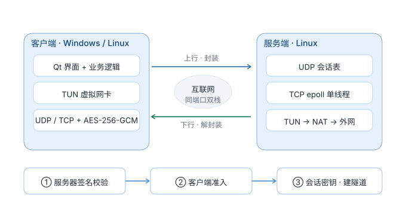

# ScholarVPN

自研 UDP/TCP 双传输隧道 + 三阶段身份认证的教学级 VPN 实现。Windows / Linux 客户端共用同一套 Qt 界面，服务端为 Linux。

---

## ⚠️ 法律声明（Legal Notice）

**本项目仅限学习、研究和技术交流**，用于理解 VPN / 隧道 / 加密协议的工作原理。**禁止**：

- ❌ 私自搭建、运营或对外提供 VPN 服务（含付费/免费、为他人转发流量、跨境代理通道）；
- ❌ 绕过网络监管、突破防火墙、非法访问境外网络或规避任何国家/地区的法律法规；
- ❌ 用于网络攻击、数据窃取、侵犯隐私、传播违法信息等任何非法用途。

使用者须遵守**所在国家/地区的全部法律法规**。在中国境内，私自搭建/运营 VPN 服务可能违反《中华人民共和国计算机信息网络国际联网管理暂行规定》等法规，使用者自行承担全部法律责任。作者与维护者不对任何使用行为及其后果负责；下载、编译、运行或分发即视为接受本声明。

> 若无法确保使用方式合法合规，请勿使用本项目。

## 架构



客户端创建虚拟网卡（**Windows 用 Wintun，Linux 用 `/dev/net/tun`**），把本机流量封装进自定义报文发往服务器；服务端从 TUN 转发到真实网络，回程反向封装。默认 UDP，运营商丢 UDP 时可切换 TCP（服务端同端口双栈，`--transport` 控制）。

客户端传输层以 `UDP` 为基类（认证 / AES-256-GCM / 心跳 / 队列全在基类），`TCP` 子类只覆写建连、发送、分帧接收三个钩子与协议版本字节（`v_udp=1` / `v_tcp=2`，错传报文在版本校验处丢弃）。全程非阻塞 socket + poll，无 sleep 轮询；服务端 TCP 为单线程 epoll。

GUI 与业务逻辑两端完全共用，平台差异收敛在 `src/platform/` 与各文件的 `#if defined(_WIN32)` 分支：

| 关注点 | Windows | Linux |
|---|---|---|
| 虚拟网卡 | Wintun（持久适配器） | `/dev/net/tun` + `IFF_TUN\|IFF_NO_PI` |
| 地址 / 路由 | IP Helper + `netsh` | `ip addr` / `ip route`（默认路由用 `0.0.0.0/1` + `128.0.0.0/1` 拆分，不覆盖系统 default） |
| DNS 防泄漏 | 备份非 TUN 网卡 DNS + 黑洞 | 优先 `resolvectl`，否则备份并改写 `/etc/resolv.conf` |
| 身份私钥 | DPAPI 加密 | 明文 + `0600` 权限 |

## 协议与加密

- **双传输**：自定义报文头（魔数 / 版本 / 类型 / 序号），版本字节即传输标识；线格式属实现细节，不展开；
- **三阶段认证**：服务器身份签名校验（防中间人）+ 客户端身份准入（注册/登录）；**认证通过前服务端不转发任何流量**；
- **加密**：OpenSSL 标准算法，会话密钥支持前向安全，数据面 AES-256-GCM；
- **心跳保活**：周期心跳，失联自动重连（指数退避）。

## 配置

客户端参数走 INI，**推荐全部在 GUI 内操作**（增删改自动维护），首次运行自动生成：

- Windows：`%APPDATA%\ScholarVPN\config.ini`
- Linux：`~/.config/scholarvpn/config.ini`（遵循 `$XDG_CONFIG_HOME`；`sudo` 运行时自动还原到调用者家目录，避免身份密钥落到 `/root`）

```ini
[Server]
Count=2

[Server1]
Name=公司服务器            # 显示名（留空默认 computer+N）
ServerIP=1.2.3.4
ServerPort=51820
Transport=0                # 0=UDP（默认） 1=TCP（运营商丢 UDP 时用，可配 443 端口）
ClientID=user1             # 显示名，不参与认证，可随意填写、无需唯一
RegisterToken=             # 首次注册填管理员下发的令牌，注册成功自动清空即登录模式
ServerPubKey=              # 可选：该服务器 Ed25519 公钥 base64；留空=用内置公钥

[Server2]
Name=home
ServerIP=5.6.7.8
ServerPort=51820
ClientID=user1

[Network]
VirtualIP=                 # 可选：留空 = 采用服务端自动分配的虚拟 IP（推荐）
VirtualPrefix=24
DNS=8.8.8.8,1.1.1.1
MTU=1400
Metric=5
```

> 多服务器按 `[ServerN]` 连接；**Debug** 构建在无任何 `[ServerN]` 时回退到 `192.168.1.12`（本地测试），**Release** 回退为空。

## 依赖

**客户端（Windows）**

| 依赖 | 说明 |
|---|---|
| VS 2022（v143）+ Windows SDK 10 | C++20 |
| Qt 6.9.1（msvc2022_64） | GUI；默认引用 `D:\Qt\6.9.1\msvc2022_64`，路径不同需改 `VPN_.vcxproj` |
| OpenSSL 3.5.6 | 已内置 `third_party/openssl`；运行需 `libcrypto-3-x64.dll` |
| Wintun 0.14.1 | 已内置 `third_party/wintun-0.14.1`；运行需 `wintun.dll` |

**客户端（Linux）**

| 依赖 | 说明 |
|---|---|
| CMake ≥ 3.16 + C++17 编译器 | GCC 9+ / Clang 10+ |
| Qt 6 Widgets / OpenSSL 3.x | 构建 `qt6-base-dev libssl-dev`，运行 `libqt6widgets6 libssl3` |
| 内核 TUN | `/dev/net/tun`（容器需 `--device /dev/net/tun`） |
| iproute2 + polkit | 路由操作用 `ip`；桌面提权用 `pkexec` |

> Linux 端不使用 `third_party/` 的预编译产物，全部链接系统库。

**服务端（Linux）**：CMake ≥ 3.16 + C++17 编译器、pthread、OpenSSL（X25519 / HKDF / AES-256-GCM）。

> 许可：Wintun 源码 GPLv2、预编译二进制另有许可（`third_party/wintun-0.14.1/prebuilt-binaries-license.txt`）；OpenSSL 见 `third_party/openssl/LICENSE`。分发前请确认兼容性。

## 构建

### 客户端（Windows）

用 VS 2022 打开 `VPN_.sln`，选 x64 + Debug/Release 生成即可；构建后自动拷贝 `libcrypto-3-x64.dll`、`wintun.dll`、`style.qss`、Qt6 DLL 与 `platforms` 插件到输出目录。命令行：

```powershell
msbuild VPN_.sln /p:Configuration=Debug /p:Platform=x64
```

> **Debug** 用内置测试服务器公钥，**Release** 用正式公钥（`src/client/ClientApp.cpp` 的 `kServerSigPubPem`，请自行更换）。也可在 GUI 中按服务器单独填写 `ServerPubKey`。

### 客户端（Linux）

```bash
sudo apt install build-essential cmake qt6-base-dev libssl-dev
cmake -S . -B build-client && cmake --build build-client -j
sudo ./build-client/vpn_client          # 需要 root：建 tun、改路由、改 DNS
```

**装成桌面应用（推荐）**：

```bash
sudo ./scripts/linux/install-linux.sh build-client/vpn_client
```

安装到 `/opt/scholarvpn/` 并注册应用菜单、图标、polkit 策略（认证一次记 5 分钟）、启动器与桌面快捷方式。之后按 **Super 搜 ScholarVPN** 或双击图标启动。

> GNOME Wayland 下 root 进程连不上 wayland compositor，必须走 XWayland（`QT_QPA_PLATFORM=xcb` + Mutter 的 XWayland cookie）；启动器 `scripts/linux/scholarvpn-gui` 已自动处理。无 polkit 的发行版直接 `sudo` 运行。

### 服务端（Linux）

```bash
cd server
cmake -S . -B build && cmake --build build
sudo ./build/vpn_server -a 10.8.0.1 -p 51820
```

常用参数：`-a/--addr`（隧道内网 IP）、`-p/--port`、`--max-clients`（默认 64，自动分配虚拟 IP）、`--transport both|udp|tcp`（默认 both 双栈）、`-k/--key`（默认 `keys/server_sig.key`）、`-g/--gen-token [n]`（生成一次性注册令牌）、`--quiet`。

**一键部署**（兼容 Debian/Ubuntu/CentOS/RHEL/Fedora/Arch/OpenWrt，自动选 iptables / nftables 并放行端口）：

```bash
cd server
sudo ./start.sh            # 前台运行（调试）
sudo ./start.sh -d         # 后台守护（异常自动重启）
sudo ./start.sh install    # 装 systemd 服务（推荐）
sudo ./start.sh status|logs|doctor|uninstall
```

关键项可用环境变量覆盖：`TUN_IP`、`TUN_PREFIX`、`TUN_MTU`、`VPN_PORT`、`LISTEN_IP`、`KEY_PATH`、`MAX_CLIENTS`、`QUIET`。`install` 会把当前配置固化到 `/etc/default/vpn-server`，改完 `systemctl restart vpn-server` 生效。日志按天轮转在 `logs/`。

首次启动自动生成 `keys/server_sig.key` / `server_sig.pub`，把公钥硬编码进客户端 `kServerSigPubPem`（防中间人）。密钥与准入数据库说明见 `server/keys/README.txt`。

### 多用户（NAT 模式）

```bash
sysctl -w net.ipv4.ip_forward=1
iptables -t nat -A POSTROUTING -s 10.8.0.0/24 -o eth0 -j MASQUERADE
sudo ./build/vpn_server -a 10.8.0.1 -p 51820 --max-clients 100
```

服务端按 **Session** 隔离每个客户端（源 IP+端口），认证后自动分配虚拟 IP；**同一 Ed25519 公钥重复登录会踢掉旧会话**；`--max-clients` 限制并发，未认证/失联会话按超时清理。

### 身份认证与注册

```bash
sudo ./build/vpn_server --gen-token 5      # 输出 register_token: <64位hex>，写入 keys/register_tokens.txt
```

客户端把令牌填入服务器的 **RegisterToken** 字段后首次连接即完成注册（令牌一次性，成功后自动清空转登录模式）；已注册公钥存 `keys/registered_clients.txt`。**私钥/令牌/注册表不得提交 Git**（`keys/*` 已忽略）。

## 使用


### 首次运行

**Windows**：双击 `ScholarVPN.exe` 可免 UAC 启动，但**建立连接需管理员**（建网卡、改路由、改 DNS），连接前右键「以管理员身份运行」。身份密钥生成在 `%APPDATA%\ScholarVPN\keys\`：`client.id.pub`（公钥，交给管理员）与 `client.id.enc`（DPAPI 加密私钥）。

**Linux**：从应用菜单启动（首次弹一次 `pkexec` 认证）或 `sudo ./build-client/vpn_client`。密钥在 `~/.config/scholarvpn/keys/`，`client.id.enc` 权限 `0600`。

> 两端 `keys/` 独立：双系统会被服务端视为**两台设备**，需各自注册。

### 添加服务器

点右上角「+ 添加服务器」，填写：

| 字段 | 说明 |
|---|---|
| 名称 | 可留空，自动命名 `computer+N` |
| 服务器 IP | 必填 |
| 传输方式 | UDP（默认）/ TCP（运营商丢 UDP 时用，可配 443 端口） |
| ClientID | 必填，仅显示用，不参与认证（真实身份是本机 Ed25519 密钥） |
| RegisterToken | 首次注册填令牌；之后留空即登录 |
| 服务器公钥 | 可选，粘贴 `server_sig.pub` 全文；留空用内置公钥 |

### 连接 / 切换 / 编辑

- 卡片显示名称、IP、服务端分配的**内网 IP**、状态；点「连接」→ 三阶段认证 → 自动采用虚拟 IP 并接管默认路由与 DNS；点红色「断开」→ 恢复路由与物理网卡 DNS；
- 断线自动重连（指数退避）；卡片下方为 60 秒实时速率曲线（下载蓝 / 上传绿）；
- 底部「⇄ Switch Server」展开服务器列表，点任一卡片即切换（连接中需先断开）；
- 卡片右上「编辑」可改字段并写回 `config.ini`，编辑窗口内「删除」二次确认后移除。

## 待完善

- **智能分流**：国内直连 / 国外走隧道，避免全局代理；
- **日志窗口与流量统计**：GUI 内查看日志、累计流量与限速；
- **开机自启**：开机启动并自动连接（托盘/最小化已实现）；
- **Linux 权限模型**：目前整个 GUI 以 root 运行；更规范的是普通用户 GUI + polkit helper 只负责 tun/路由/DNS；
- **Linux 桌面细节**：GNOME 默认不显示桌面图标（需 `desktop-icons-ng`）；托盘依赖 `libappindicator`。

## 许可证

MIT（见 `LICENSE`）。第三方组件许可见 `docs/LICENSE.txt` 与 `third_party/` 下对应文件。

---

> ⚠️ 再次提醒：本项目**仅限学习研究**，**禁止私自搭建/运营 VPN 服务**。请遵守所在地法律法规。
